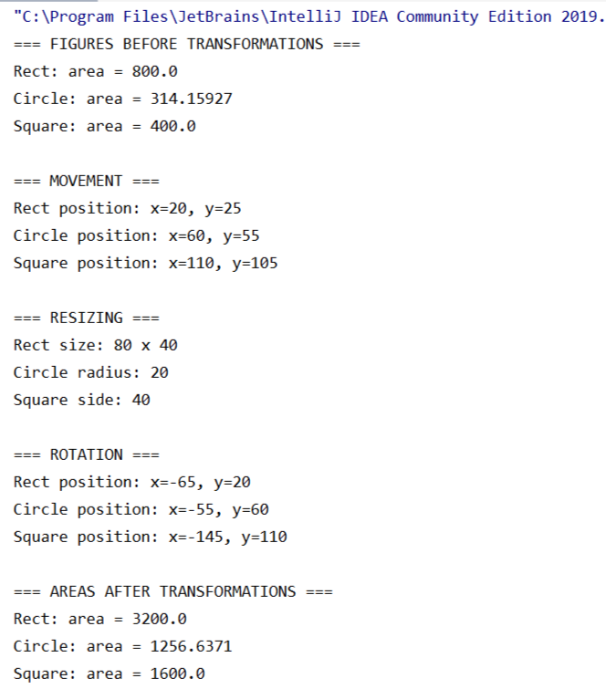
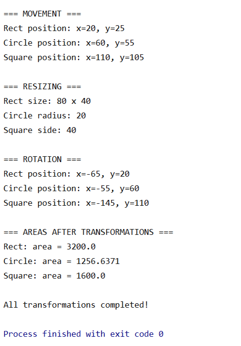

# Figures — преобразование геометрических фигур

## Описание проекта

Проект реализует работу с геометрическими фигурами на языке Kotlin. Созданы три типа фигур: прямоугольник (`Rect`), круг (`Circle`) и квадрат (`Square`).

## Реализованные возможности

Для всех трёх фигур реализованы следующие операции:

- **Перемещение (`move`)** — изменение положения фигуры.
- **Масштабирование (`resize`)** — увеличение размеров фигуры с сохранением пропорций.
- **Поворот (`rotate`)** — поворот фигуры на 90 градусов по часовой стрелке или против неё относительно заданной точки.
- **Вычисление площади (`area`)** — расчёт площади геометрической фигуры.

Для реализации преобразований используется интерфейс `Transforming`, а для перемещения — интерфейс `Movable`. Все фигуры наследуются от базового класса `Figure`.

## Тестирование

В функции `main()` проверяется работа всех трёх фигур:

1. Вычисление исходной площади.
2. Перемещение фигур.
3. Увеличение размеров в два раза.
4. Поворот по часовой стрелке.
5. Повторное вычисление площади после преобразований.

Программа успешно запускается и выводит результаты операций в консоль.

## Технологии

- Kotlin
- IntelliJ IDEA

## Результат работы

Ниже представлен результат выполнения программы:
## Демонстрация работы

### Скриншот 1

### Скриншот 2

